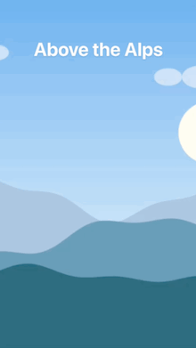

# Kadr

[](https://github.com/SteliyanH/kadr/actions/workflows/ci.yml)
[](https://swiftpackageindex.com/SteliyanH/kadr)
[](https://swiftpackageindex.com/SteliyanH/kadr)
[](LICENSE)
[](https://buymeacoffee.com/steliyanh)

**SwiftUI for video. Compose, transform, export — in Swift you actually want to write.**

A declarative Swift library for video on Apple platforms: a result-builder DSL,
async/await throughout, and nothing underneath but AVFoundation.

<p align="center">
  
</p>

That video is the code below, rendered by kadr. Every GIF on this page comes
from the snippet printed beside it. They are re-rendered by
`swift run KadrReadmeMedia`, and CI compiles every snippet.

<!-- readme-snippet: hero -->
```swift
let video = Video {
    ImageClip(coast, duration: 4)
        .transform(.identity, animation: .keyframes([                 // Ken Burns
            .at(0.0, value: Transform(scale: 1.0)),
            .at(4.0, value: Transform(center: .normalized(x: 0.6, y: 0.45), scale: 1.3)),
        ], timing: .easeInOut))
    Transition.dissolve(duration: 0.8)
    VideoClip(url: droneURL).trimmed(to: 0...5)
    VideoClip(url: reactionURL).trimmed(to: 0...3)                    // picture-in-picture
        .at(time: 4.5)
        .transform(Transform(center: .normalized(x: 0.96, y: 0.06), scale: 0.32, anchor: .topRight))
}
.overlay(
    TextOverlay("kadr", style: TextStyle(fontSize: 240, alignment: .center, weight: .bold))
        .position(.center)
        .visible(during: 0.4...3.2)
        .animation(.scaleUp(duration: 0.6))
)
.audio(url: musicURL)
.preset(.cinema)

let url = try await video.export(to: outputURL)
```

## Quick Start

This needs no media files: `SampleMedia` draws its own frames. There are no
overlays either, so it also runs in the iOS Simulator.

```swift
import Kadr

let output = FileManager.default.temporaryDirectory.appendingPathComponent("hello.mp4")

let url = try await Video {
    ImageClip(SampleMedia.image(index: 0), duration: 2)
    Transition.dissolve(duration: 0.5)
    ImageClip(SampleMedia.image(index: 1), duration: 2)
}
.preset(.reelsAndShorts)          // 1080×1920, 30 fps
.export(to: output)
```

Call it from any async context: a SwiftUI `.task`, a test, or a Playground. To
use your own media, swap in `VideoClip(url:)` and `ImageClip(_:duration:)`.

## Installation

Add kadr to your `Package.swift`:

<!-- readme-snippets: skip -->
```swift
dependencies: [
    .package(url: "https://github.com/SteliyanH/kadr.git", from: "1.3.0")
]
```

Or in Xcode: **File › Add Package Dependencies…** and enter the repository URL.

**Requires** Xcode 26 or later (Swift 6.2), and iOS 17, macOS 14, tvOS 17 or
visionOS 1. Xcode 16 cannot build kadr: the image types it stores are only
`Sendable` in the Xcode 26 SDKs.

> **Known issue: overlays in the iOS Simulator.** Exports with text or image
> overlays throw on the iOS Simulator, because Core Animation export is broken
> there. They work on devices and on macOS. Details and workarounds:
> [Known Platform Issues](https://swiftpackageindex.com/SteliyanH/kadr/documentation/kadr/knownplatformissues).

## Recipes

Each recipe is under 20 lines. More are in [`Examples/`](Examples).

### Slideshow with music


<!-- readme-snippet: slideshow -->
```swift
let kenBurns = Animation<Transform>.keyframes([
    .at(0.0, value: Transform(scale: 1.0)),
    .at(3.0, value: Transform(scale: 1.15)),
])

let url = try await Video {
    ImageClip(coast, duration: 3).transform(.identity, animation: kenBurns)
    Transition.dissolve(duration: 0.6)
    ImageClip(mountains, duration: 3).transform(.identity, animation: kenBurns)
    Transition.dissolve(duration: 0.6)
    ImageClip(lake, duration: 3).transform(.identity, animation: kenBurns)
}
.audio(url: musicURL)
.preset(.cinema)
.export(to: outputURL)
```

### Vertical video for Reels, Shorts and TikTok



<!-- readme-snippet: vertical -->
```swift
// Landscape footage in, 1080×1920 out: the clip is scaled to fill the frame.
let url = try await Video {
    VideoClip(url: droneURL).trimmed(to: 0...6)
}
.overlay(
    TextOverlay("Above the Alps", style: TextStyle(fontSize: 104, alignment: .center,
                                                   weight: .bold, shadow: TextShadow()))
        .position(.normalized(x: 0.5, y: 0.14))
)
.preset(.reelsAndShorts)
.export(to: outputURL)
```

### Picture-in-picture reaction


<!-- readme-snippet: pip -->
```swift
let url = try await Video {
    VideoClip(url: droneURL).trimmed(to: 0...6)
    VideoClip(url: reactionURL).trimmed(to: 0...5)      // a second layer, from 0.5 s
        .at(time: 0.5)
        .transform(Transform(center: .normalized(x: 0.96, y: 0.06), scale: 0.35, anchor: .topRight))
}
.preset(.cinema)
.export(to: outputURL)
```

### Green screen


<!-- readme-snippet: greenScreen -->
```swift
let url = try await Video {
    ImageClip(dusk, duration: 5)                        // the backdrop
    VideoClip(url: presenterURL)                        // filmed on green
        .filter(.chromaKey(color: .green, threshold: 0.35))
        .at(time: 0)
}
.preset(.cinema)
.export(to: outputURL)
```

### Speed ramp


<!-- readme-snippet: speedRamp -->
```swift
let ramp = Animation<Double>.keyframes([
    .at(0.0, value: 1.0),
    .at(1.2, value: 0.25),      // into slow motion…
    .at(2.4, value: 2.0),       // …then double speed
    .at(4.0, value: 1.0),
])

let url = try await Video {
    VideoClip(url: rollURL).speed(.curved(ramp))
}
.preset(.cinema)
.export(to: outputURL)
```

### Animated titles


<!-- readme-snippet: titles -->
```swift
let title = TextStyle(fontSize: 132, weight: .bold, stroke: TextStroke(width: 4), shadow: TextShadow(blur: 8))
let subtitle = TextStyle(fontSize: 64, weight: .medium, shadow: TextShadow(blur: 6))

let url = try await Video {
    VideoClip(url: droneURL).trimmed(to: 0...5)
}
.overlay(
    TextOverlay("Chapter one", style: title)
        .position(.normalized(x: 0.06, y: 0.72)).anchor(.bottomLeft)
        .visible(during: 0.3...5.0)
        .animation(.slideIn(from: .fromLeft, duration: 0.6))
)
.overlay(
    TextOverlay("The long way up", style: subtitle)
        .position(.normalized(x: 0.06, y: 0.82)).anchor(.bottomLeft)
        .visible(during: 1.0...5.0)
        .animation(.fadeIn(duration: 0.6))
)
.preset(.cinema)
.export(to: outputURL)
```

## Why kadr?

FFmpegKit retired in January 2025. Pixel SDK sunset in February 2025. AVFoundation is powerful but verbose. The Swift video ecosystem needs a modern, native, declarative library.

Here is a 9:16 export of one clip in kadr. If the camera stored the clip
rotated, kadr turns it upright, then scales it to fill the frame and centres it:

<!-- readme-snippet: kadrVertical -->
```swift
let url = try await Video { VideoClip(url: droneURL).trimmed(to: 0...6) }
    .preset(.reelsAndShorts)
    .export(to: outputURL)
```

And here is the same export in AVFoundation. `swift run KadrReadmeMedia`
runs both and checks that their frames match.

<details>
<summary><b>The same export in raw AVFoundation: 40 lines</b></summary>

<!-- readme-snippet: rawAVFoundation -->
```swift
func exportVertical(source: URL, to output: URL) async throws {
    let asset = AVURLAsset(url: source)
    let composition = AVMutableComposition()
    let range = CMTimeRange(start: .zero, duration: CMTime(seconds: 6, preferredTimescale: 600))

    guard let sourceVideo = try await asset.loadTracks(withMediaType: .video).first,
          let video = composition.addMutableTrack(withMediaType: .video,
                                                  preferredTrackID: kCMPersistentTrackID_Invalid)
    else { throw CocoaError(.fileReadCorruptFile) }
    try video.insertTimeRange(range, of: sourceVideo, at: .zero)

    if let sourceAudio = try await asset.loadTracks(withMediaType: .audio).first,
       let audio = composition.addMutableTrack(withMediaType: .audio,
                                               preferredTrackID: kCMPersistentTrackID_Invalid) {
        try audio.insertTimeRange(range, of: sourceAudio, at: .zero)
    }

    // Turn the frame upright, scale it to fill 1080×1920, and centre it.
    let renderSize = CGSize(width: 1080, height: 1920)
    let (naturalSize, preferred) = try await sourceVideo.load(.naturalSize, .preferredTransform)
    let upright = CGRect(origin: .zero, size: naturalSize).applying(preferred)
    let scale = max(renderSize.width / upright.width, renderSize.height / upright.height)
    let transform = preferred
        .concatenating(CGAffineTransform(translationX: -upright.minX, y: -upright.minY))
        .concatenating(CGAffineTransform(scaleX: scale, y: scale))
        .concatenating(CGAffineTransform(translationX: (renderSize.width - upright.width * scale) / 2,
                                         y: (renderSize.height - upright.height * scale) / 2))

    let layer = AVMutableVideoCompositionLayerInstruction(assetTrack: video)
    layer.setTransform(transform, at: .zero)
    let instruction = AVMutableVideoCompositionInstruction()
    instruction.timeRange = range
    instruction.layerInstructions = [layer]
    let videoComposition = AVMutableVideoComposition()
    videoComposition.renderSize = renderSize
    videoComposition.frameDuration = CMTime(value: 1, timescale: 30)
    videoComposition.instructions = [instruction]

    guard let session = AVAssetExportSession(asset: composition,
                                             presetName: AVAssetExportPresetHighestQuality)
    else { throw CocoaError(.featureUnsupported) }
    session.videoComposition = videoComposition
    try await session.export(to: output, as: .mp4)
}

try await exportVertical(source: droneURL, to: outputURL)
```

</details>

### Compared with the alternatives

| | Kadr | AVFoundation (raw) | VideoLab | FFmpegKit |
|---|---|---|---|---|
| **API style** | Declarative DSL | Imperative | Layer-based | CLI wrapper |
| **Swift concurrency** | async/await native | Callbacks | No | No |
| **Swift 6 / Sendable** | Full strict concurrency | Partial | No | No |
| **Maintained (2026)** | Active | Apple (low-level) | Inactive | Retired (Jan 2025) |
| **Dependencies** | None (AVFoundation only) | N/A | None | FFmpeg binary |
| **Learning curve** | Minutes | Hours | Hours | Moderate |
| **License** | Apache 2.0 | Proprietary | MIT | LGPL |

## Features

Everything below is in the shipping public API. For what changed in which
release, see [CHANGELOG.md](CHANGELOG.md) — it is not duplicated here, so it
cannot drift out of date here either.

**Composition**
- Result-builder DSL over `Video`, `Track`, `VideoClip`, `ImageClip` and `TitleSequence`, `async`/`await` throughout, no third-party dependencies.
- Multi-track timelines with named lanes and per-track opacity; time-anchored audio tracks.
- `KadrVideoCompositor` for custom per-frame compositing, and `makePlayerItem()` so a composition previews before it exports.

**Transform and animation**
- `Transform(center:rotation:scale:anchor:)` on every clip type — picture-in-picture, scaled cutaways, rotated clips.
- `Animation<T>` with `Animatable` conformances for `Transform`, `Double`, `Position` and `Size`. `TimingFunction` covers linear, ease-in/out, cubic Bézier and custom closures.
- **Keyframes are clip-relative**: a keyframe at `0.0` maps to the clip's first frame, not composition zero. The same animations drive export and live preview.

**Filters**
- Animatable presets including brightness, contrast, saturation, exposure, sepia, gaussian blur, vignette, sharpen, zoom blur and glow.
- Keyed by `FilterID`, so animations bound to a filter survive reordering instead of drifting onto their neighbours.

**Overlays and text**
- `TextOverlay` with built-in animation recipes (`.fadeIn`, `.slideIn`, `.scaleUp`), plus `ImageOverlay` and `StickerOverlay` with animatable position and size.
- `TextStyle` carries `TextStroke` and `TextShadow` — legible copy over busy footage.

**Audio**
- Per-track volume, fades, ducking, `volumeRamp(start:end:during:)` and declaration-ordered `crossfade(_:)`.
- Pitch-preserving speed from 0.25× to 4× via `AudioTimePitchAlgorithm` (`.spectral`, `.timeDomain`, `.varispeed`).

**Timing**
- `Speed` is `.flat(Double)` or `.curved(Animation<Double>)`, so a clip is one or the other at compile time. A number literal is a flat rate: `.speed(0.5)` is half speed. Curved rates are integrated into a piecewise-linear time map that audio follows.

**Captions**
- `Caption` value type and `Video.captions(_:)` bake cues as an `AVMetadataItem` group at export. File parsing for SRT, VTT, iTT, ASS and SSA lives in [`kadr-captions`](https://github.com/SteliyanH/kadr-captions); the core stays a bridge.

**Export**
- `ThumbnailGenerator` reuses one `AVAssetImageGenerator` across many frame requests, with a batch `AsyncThrowingStream` for filmstrips and cooperative `cancel()`.
- `CancellationToken` backed by real synchronisation, not an unchecked claim.

### Roadmap

See [ROADMAP.md](ROADMAP.md) for the full version plan.

## Companion packages

Kadr is the engine. Five packages consume its public
surface for specific jobs — pull in only what you need; none are required for
composition or export.

| Package | Purpose |
|---|---|
| [`kadr-ui`](https://github.com/SteliyanH/kadr-ui) | SwiftUI components — `VideoPreview`, `ThumbnailStrip`, multi-lane `TimelineView` (selection / reorder / trim / scrub / audio waveforms), `OverlayHost` with gesture-routed `LayerID` hit-testing, `InspectorPanel` with filter authoring, `TransitionPicker`, `ClipSplitter`, `KeyframeEditor`. |
| [`kadr-persistence`](https://github.com/SteliyanH/kadr-persistence) | Save a composition to a file and open it again — refusing, rather than silently dropping, whatever a file cannot hold. Content-addressed image storage; a completeness guard that fails when kadr grows a field. |
| [`kadr-audio`](https://github.com/SteliyanH/kadr-audio) | Music-library resolution, in-app voiceover recording, audio session policy, and ITU-R BS.1770-4 (LUFS) loudness measurement. |
| [`kadr-captions`](https://github.com/SteliyanH/kadr-captions) | Caption parsing and authoring for SRT, VTT, iTT, ASS and SSA, plus a styled-VTT bridge onto `TextOverlay` + `textAnimation` for burned-in animated captions. |
| [`kadr-photos`](https://github.com/SteliyanH/kadr-photos) | Photos library integration — resolves video / image / Live Photo `PHAsset`s into kadr clip types, wraps `PHPickerViewController` for SwiftUI, bridges assets to `ImageOverlay` / `StickerOverlay`. |

And a reference application: [**Kadr Studio**](https://github.com/SteliyanH/kadr-reels-studio),
a short-form vertical video editor built on all six.

## API stability

From **v1.0.0**, kadr follows semantic versioning without asterisks:

- **No breaking change without a major bump.** Nothing public is removed,
  renamed, or given a different meaning inside `1.x`.
- **Minors add.** New filters, new modifiers, new overlay kinds — all additive,
  all source-compatible.
- **Deprecation before removal.** Anything on its way out is marked
  `@available(*, deprecated:)` for at least one minor with a named replacement,
  and can only actually disappear in a major.

What this does *not* promise: `internal` symbols, the exact bytes an export
produces (encoders change under us), and performance figures — those are tracked
as a regression baseline in [`Benchmarks/README.md`](Benchmarks/README.md), not
as a contract.

## Platform Support

| Platform | Minimum Version |
|---|---|
| iOS | 17.0 |
| macOS | 14.0 |
| tvOS | 17.0 |
| visionOS | 1.0 |

## Architecture

Kadr separates the public DSL from the internal engine:

- **DSL layer** *(public, semver-stable)* — `Video`, `Track`, `VideoClip`, `ImageClip`, `TitleSequence`, `Transition`, `AudioTrack`, `Preset`, `Exporter`, `Filter`, `Animation<T>`, `Transform`, plus the overlay / compositor / animation surfaces.
- **Engine layer** *(internal, uses AVFoundation)* — `CompositionBuilder` (timeline assembly + multi-track routing), `FilterProcessor` (per-frame `CIFilter` pre-render with intensity animation), `KadrVideoCompositor` (custom `AVVideoCompositing` for multi-input compositors), `OverlayRenderer` (CALayer tree for `AVVideoCompositionCoreAnimationTool`), `PlaybackComposer` (`AVPlayerItem` for previews), `ExportEngine` (`AVAssetExportSession` driver), `ImageEncoder` (still-image fast path), `ReverseProcessor`.

The DSL is the stable public API. The engine is the implementation detail that can be refactored without breaking semver.

## Contributing

Contributions are welcome! See [CONTRIBUTING.md](CONTRIBUTING.md) for guidelines.

## License

Apache 2.0 — see [LICENSE](LICENSE) for details.

Contributions are accepted under the [Contributor License Agreement](CLA.md), which is signed once and covers all future contributions. It does not transfer ownership — you keep the copyright in your work.

Apache 2.0 was chosen over MIT for its explicit patent grant, which is relevant for video processing code that touches codec patents (H.264, HEVC).
